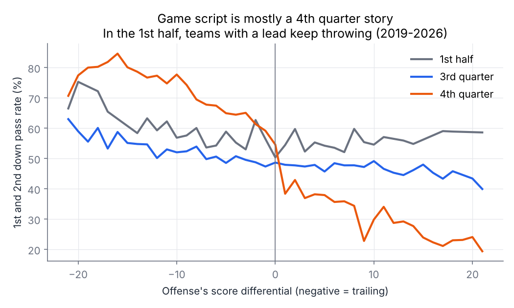
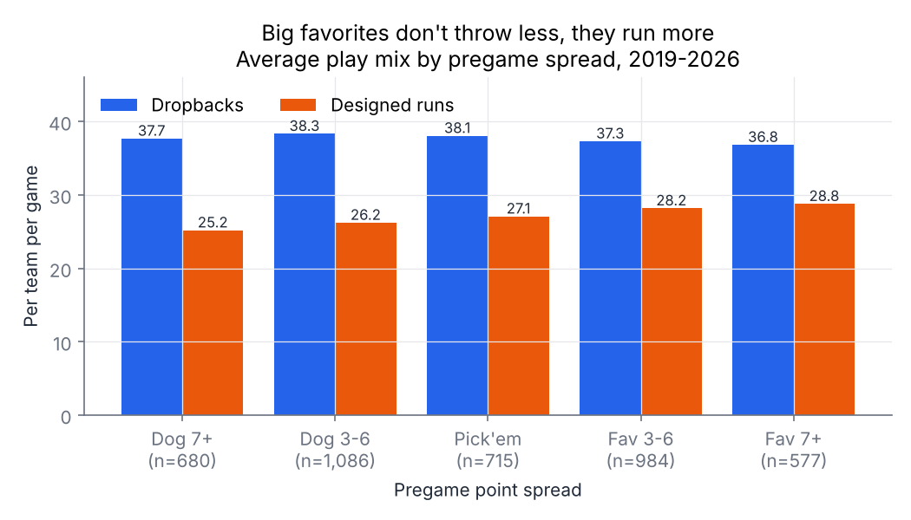
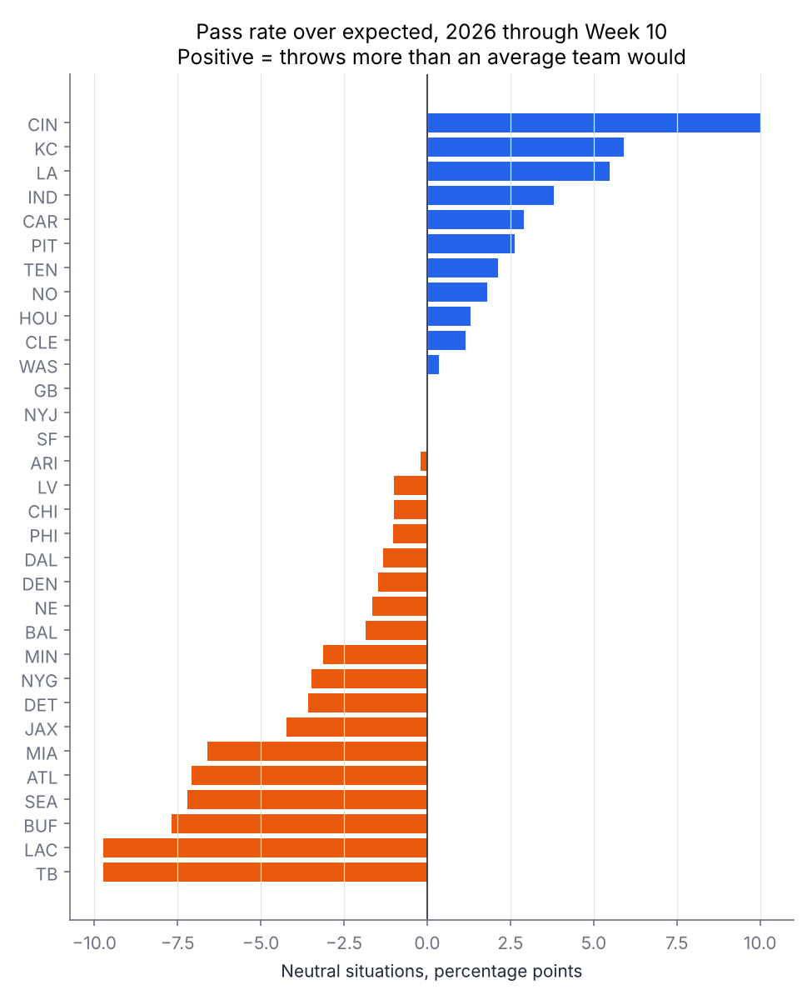
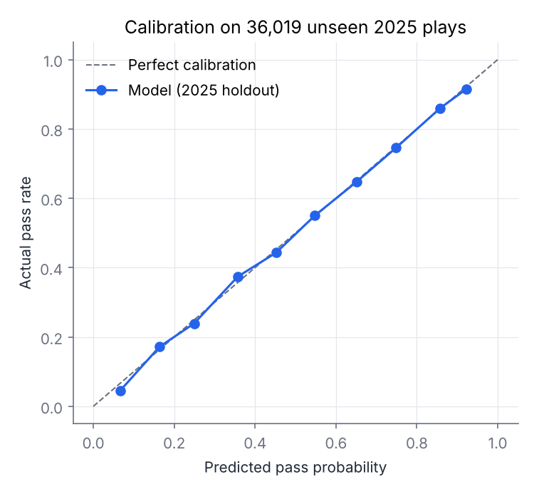

# Game script: an expected pass rate model for the NFL

[](https://github.com/vincentweikum/game-script/actions/workflows/ci.yml)

A machine learning model that predicts how often an average NFL offense would pass in any game situation, trained on **273,189 run/pass plays from 2019 through Week 10 of 2026**. Comparing what teams actually call to what the situation calls for gives **pass rate over expected (PROE)**, the cleanest public read on a coach's real tendencies. The project then uses the model to answer a question I care about for betting and fantasy: how much does **game script** (the score and the pregame spread) drive a team's play mix?

## Results

**The model.** A gradient boosted classifier trained on 2019 to 2024 and scored on the full unseen 2025 season (36,019 plays):

| Model | Log loss | Brier | AUC | Accuracy |
|---|---|---|---|---|
| **Gradient boosting (this project)** | **0.563** | **0.191** | **0.769** | **70.0%** |
| nflverse's published `xpass` | 0.582 | 0.196 | 0.764 | 69.4% |
| Logistic regression, same features | 0.615 | 0.212 | 0.713 | 66.0% |
| Down and distance lookup table | 0.618 | 0.215 | 0.691 | 63.8% |

It correlates at **0.97** with nflverse's own expected pass model (a good sign it's measuring the same thing) while scoring a little better on these plays, and it's well calibrated across the whole range (chart below).

**Game script is mostly a 4th quarter story.** On 1st and 2nd down in the first half, teams leading by 14 still pass **55%** of the time, *more* than in a tied game (50%). Teams that build early leads tend to be good passing teams, and coaches don't shut it down yet. In the 4th quarter the gap explodes: **79%** pass rate trailing by 14 versus **28%** leading by 14.

**Big favorites don't throw less, they run more.** Teams favored by 7+ average 36.8 dropbacks and **28.8** designed runs a game. Underdogs of 7+ average 37.7 dropbacks and **25.2** runs. Dropbacks barely move with the spread; the volume shift shows up almost entirely in the run game. For fantasy, that's a case for leaning on a big favorite's running back, and against expecting much extra passing volume from a big underdog.

**PROE is a real team trait, but only partly.** A team's neutral-situation PROE in weeks 1 to 9 correlates **0.54** with its PROE in weeks 10 to 18 (224 team halves, 2019 to 2025), a bit stickier than raw pass rate (0.50). Year to year it drops to **0.36**, which fits with coaching and quarterback changes resetting a team's identity.

**2026 so far (through Week 10).** In neutral situations Cincinnati passes **10.0 points** more than expected, followed by Kansas City (+5.9) and the Rams (+5.5). Tampa Bay and the Chargers are the most run-heavy relative to the situation (both **-9.7**). With 233 to 353 neutral plays per team, each number has a 95% margin of error of roughly plus or minus 5 to 6 points, so the middle of the table is mostly noise; the ends aren't.

| | |
|---|---|
|  |  |
|  |  |

Full numbers are in [`reports/findings.json`](reports/findings.json), the 2026 team table in [`reports/team_proe_2026.csv`](reports/team_proe_2026.csv).

## How it works

**Which plays count.** Every snap where a team chose to run or pass on downs 1 to 4. Kneels, spikes, two-point tries and penalties with no play are dropped. Scrambles count as passes, because the call was a pass.

**Features are game state only.** Down, distance, field position, quarter, clock, timeouts, score, win probability, the pregame spread and implied team total, home or away, and weather. Nothing identifies the team, and nothing the offense chooses at the snap (shotgun, no-huddle) is used, so anything "over expected" is left for the team to explain.

**No leakage.** Model evaluation trains on 2019 to 2024 and tests on 2025. For the PROE numbers, every season is scored by a model that never saw it (leave one season out), including 2026.

**"Neutral situations"** means win probability between 20% and 80%, downs 1 to 3, quarters 1 to 3, and not in the last two minutes of a half: the snaps where the score isn't making the decision for the coach.

## Run it

```bash
pip install -r requirements.txt
make all       # download play-by-play (~160 MB), run the analysis, run tests
```

The analysis takes about 40 seconds on a laptop. CI runs unit tests on every push and reruns the full analysis on fresh data every Tuesday during the season.

## Data

Play-by-play from [nflverse](https://github.com/nflverse/nflverse-data). Data isn't committed to the repo; `make data` downloads it.

## Stack

Python, pandas, scikit-learn (HistGradientBoosting), matplotlib, pytest, GitHub Actions
